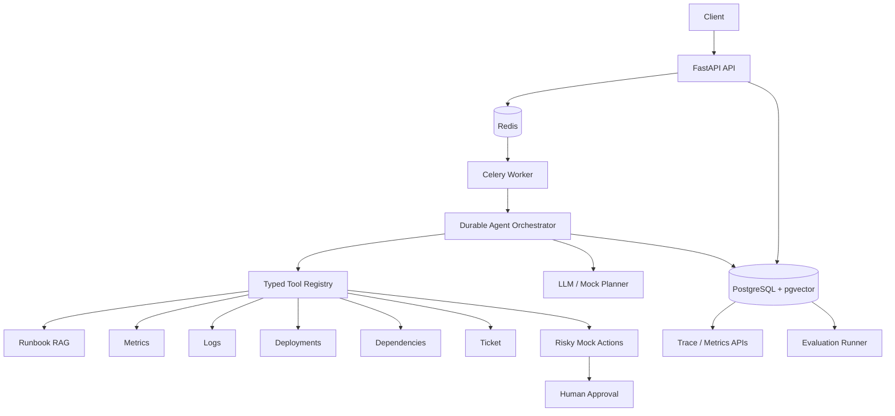

# ReliableOps

**ReliableOps** is a production-style, durable incident-investigation agent. It is designed to demonstrate backend engineering, distributed systems, agent orchestration, typed tool use, RAG, persistent memory, approval-gated actions, observability, evaluation, idempotency, retries, and crash recovery.

It is intentionally **not** a chatbot. The LLM (or the deterministic local planner) proposes decisions; application code owns execution, permissions, state transitions, retries, persistence, and safety.

## What you can demo

Submit an incident such as:

> `payment-service API latency increased by 40% after the latest deployment at 10:05. Investigate the cause.`

ReliableOps will retrieve runbooks, inspect deployments, query simulated metrics and logs, inspect dependencies, build a grounded root-cause hypothesis, pause before a risky rollback, persist an approval request, resume after approval/rejection, generate a structured report, expose the complete trace, and score itself against evaluation cases.

The built-in payment scenario contains this evidence:

- `payment-service v1.4.2` deployed at 10:05.
- Latency rises at 10:08.
- Database pool utilization reaches 100% at 10:10.
- Logs report `timeout waiting for database connection from pool`.
- The runbook explains the diagnostic signature.

A second scenario deliberately places an `order-service` deployment near an incident even though the real cause is `auth-service` CPU saturation. This tests whether the agent can avoid confusing correlation with causation.

---

## Architecture



### Core invariant

**PostgreSQL is the source of truth. Redis transports work; it does not own agent state.**

Every completed agent step is checkpointed. If a worker dies, a new worker reconstructs the run from persisted steps, memories, approvals, and the current step number. Risky actions are only executed if the exact persisted action payload has an approved approval record.

---

## Tech stack

- Python 3.11+
- FastAPI
- Pydantic v2
- SQLAlchemy 2
- PostgreSQL 16
- pgvector
- Celery
- Redis
- httpx
- pytest
- Docker Compose

### LLM providers

The default provider is `mock`, which is deterministic and requires **no API key**. This makes the entire project runnable locally and suitable for CI and interview demos.

Set `LLM_PROVIDER=openai_compatible` to use an OpenAI-compatible `/chat/completions` API through:

- `LLM_BASE_URL`
- `LLM_API_KEY`
- `LLM_MODEL`

No keys are hardcoded.

---

## Project layout

```text
reliableops/
├── app/
│   ├── api/                  # FastAPI routes
│   ├── core/                 # config, enums, exceptions, logging
│   ├── db/                   # SQLAlchemy base/session/models
│   ├── schemas/              # API request/response models
│   ├── agent/                # context, planner, decisions, orchestrator
│   ├── llm/                  # swappable LLM clients
│   ├── tools/                # typed tools, registry, policy/executor
│   ├── rag/                  # chunking, embeddings, ingestion, retrieval
│   ├── services/             # incident, approval, memory, evaluation services
│   ├── workers/              # Celery application/tasks
│   ├── evals/                # runner, scoring, datasets
│   └── mock_data/            # metrics, logs, deployments, runbooks
├── tests/
│   ├── unit/
│   ├── integration/
│   └── failure/
├── scripts/
├── docker-compose.yml
├── Dockerfile
├── .env
├── .env.example
├── pyproject.toml
└── README.md
```

---

# Quick start

## Requirements

- Docker Desktop / Docker Engine with Compose

No model API key is required for the default demo.

## Start everything

```bash
docker compose up --build
```

This starts:

- FastAPI on `http://localhost:8000`
- PostgreSQL + pgvector on port `5432`
- Redis on port `6379`
- Celery worker

Open Swagger:

```text
http://localhost:8000/docs
```

Check health:

```bash
curl http://localhost:8000/health
```

Expected:

```json
{
  "status": "ok",
  "checks": {
    "database": true,
    "redis": true
  }
}
```

---

# End-to-end demo

## 1. Create an incident

```bash
curl -s -X POST http://localhost:8000/incidents \
  -H 'Content-Type: application/json' \
  -d '{
    "title": "Payment latency after deployment",
    "description": "payment-service API latency increased by 40% after the latest deployment at 10:05. Investigate the cause.",
    "severity": "SEV2"
  }'
```

Copy the returned incident `id`.

## 2. Start an investigation

```bash
curl -s -X POST http://localhost:8000/incidents/INCIDENT_ID/investigate \
  -H 'Content-Type: application/json' \
  -H 'Idempotency-Key: payment-demo-001' \
  -d '{}'
```

Calling the same endpoint again with the same idempotency key returns the same run rather than creating a duplicate.

## 3. Inspect the run

```bash
curl -s http://localhost:8000/runs/RUN_ID
curl -s http://localhost:8000/runs/RUN_ID/steps
curl -s http://localhost:8000/runs/RUN_ID/trace
curl -s http://localhost:8000/runs/RUN_ID/metrics
```

The payment scenario should eventually pause with:

```text
WAITING_FOR_APPROVAL
```

## 4. Inspect pending approvals

```bash
curl -s http://localhost:8000/approvals/pending
```

The payload will contain an approval for:

```json
{
  "action": "rollback_deployment",
  "action_payload": {
    "service": "payment-service",
    "version": "v1.4.2"
  }
}
```

## 5. Approve or reject

Approve:

```bash
curl -s -X POST http://localhost:8000/approvals/APPROVAL_ID/approve \
  -H 'Content-Type: application/json' \
  -d '{"resolved_by":"incident-commander@example.local"}'
```

Or reject:

```bash
curl -s -X POST http://localhost:8000/approvals/APPROVAL_ID/reject \
  -H 'Content-Type: application/json' \
  -d '{"resolved_by":"incident-commander@example.local"}'
```

Approval causes a new worker invocation to reload the persisted checkpoint and execute the exact approved action payload. Rejection is recorded as evidence and the deterministic agent selects a safe alternative (`create_ticket`) instead of retrying the rejected action.

## 6. Read the final report

```bash
curl -s http://localhost:8000/runs/RUN_ID
```

Representative report:

```json
{
  "incident_summary": "payment-service API latency increased by 40%...",
  "root_cause": "database connection pool exhaustion introduced by payment-service v1.4.2",
  "confidence": 0.93,
  "supporting_evidence": [
    {"source": "deployment", "detail": "payment-service v1.4.2 ..."},
    {"source": "metrics", "detail": "database_connections ranged from 63.00 to 100.00 ..."},
    {"source": "logs", "detail": "checkout failed: database connection acquisition timeout"}
  ],
  "related_deployment": "payment-service v1.4.2 at 2026-10-05T10:05:00Z",
  "recommended_actions": [
    "Rollback payment-service v1.4.2 if approved...",
    "Audit connection lifecycle changes...",
    "Load-test the corrected build..."
  ],
  "runbook_sources": ["database_pool_exhaustion.md"]
}
```

---

# Run evaluations

Via API:

```bash
curl -s -X POST http://localhost:8000/evals/run \
  -H 'Content-Type: application/json' \
  -d '{"agent_version":"v1"}'
```

Or inside the API container:

```bash
docker compose exec api python scripts/run_evals.py
```

Evaluation cases contain:

```json
{
  "incident": {},
  "expected_root_cause": "...",
  "expected_tools": [],
  "required_evidence": [],
  "forbidden_actions": []
}
```

Metrics:

- task success
- tool selection
- groundedness
- safety
- completeness
- efficiency
- average step count
- average latency

The evaluation runner uses the **same orchestrator and tools as normal execution**. For safety, it rejects pending risky actions during evals rather than automatically approving them.

---

# Tests

Run locally after installing dependencies:

```bash
python -m venv .venv
source .venv/bin/activate
pip install -e '.[dev]'
pytest
```

Or in Docker:

```bash
docker compose run --rm api pip install -e '.[dev]'
docker compose run --rm api pytest
```

Coverage includes:

### Unit

- restricted tool registry
- unknown tool rejection
- tool input/output validation
- transient retry behavior
- timeout budgets
- approval policy
- RAG ingestion/retrieval
- evaluation scoring
- structured decision validation

### Integration

- create incident
- idempotent investigation creation
- tool execution
- persisted ordered steps
- approval creation
- approval/resume
- rejection/safe alternative
- final report
- trace and metrics APIs
- evaluation endpoint

### Failure/recovery

- malformed structured decision
- invalid/arbitrary action type
- tool timeout
- transient tool failure
- max-step limit
- database exception propagation from worker
- worker restart/resume from persisted approval checkpoint

---

# Reliability design

## Background workers

Incident investigations can take seconds or minutes and may pause for hours waiting on approval. They should not hold an HTTP request open. FastAPI creates durable run state and dispatches a Celery task.

## Checkpointing

After each tool decision the system persists:

- ordered step number
- concise reasoning/decision summary
- tool name
- validated tool input
- output or normalized error
- status
- latency
- retry count
- working memory
- run state

The project never stores private hidden chain-of-thought.

## At-least-once execution + idempotency

Celery tasks are configured with late acknowledgement and worker-loss rejection. Distributed queues can redeliver work, so correctness does not depend on exactly-once delivery.

Protection includes:

- `Idempotency-Key` for investigation creation
- unique `(run_id, step_number)` constraint
- deterministic step advancement
- idempotent side-effect execution keys
- durable approval payloads

## Retries

The central `ToolExecutor` retries transient tool failures with bounded exponential backoff. Built-in tools are local; each call has a timeout budget. Real network tool adapters should also configure transport-level timeouts so blocked I/O is actively cancelled.

The OpenAI-compatible LLM client retries malformed structured responses and HTTP failures with repair instructions. Pydantic is the final authority on whether a planner decision is valid.

## Failure isolation

A failed tool becomes a persisted failed step. The planner can continue with other evidence rather than losing the entire investigation. Infrastructure failures such as a failed database checkpoint are intentionally not swallowed by the worker: the task fails so queue-level redelivery/recovery can occur.

## Loop protection

- maximum total agent steps
- maximum number of identical tool signatures
- registered-tool-only execution

---

# Tool security model

The LLM never invokes Python functions directly.

Flow:

```text
planner output
    -> Pydantic validation
    -> allow-listed ToolRegistry lookup
    -> input schema validation
    -> policy / risk classification
    -> approval gate if necessary
    -> ToolExecutor
    -> output schema validation
    -> durable checkpoint
```

Available tools:

- `search_runbooks`
- `query_metrics`
- `search_logs`
- `get_recent_deployments`
- `get_service_dependencies`
- `create_ticket`
- `rollback_deployment` — approval required
- `restart_service` — approval required

No `eval`, dynamic import, shell execution, or arbitrary tool names are used.

---

# RAG

Runbooks are Markdown documents that are:

1. ingested
2. chunked
3. embedded
4. stored in `knowledge_chunks`
5. retrieved by similarity

The default embedding implementation is a deterministic 64-dimensional hashing embedder. It is intentionally lightweight so the project works without another model/service. The database still stores vectors through pgvector, and the interface can be replaced by a production embedding provider without changing the agent or RAG contracts.

PostgreSQL uses pgvector cosine distance. Tests fall back to in-process cosine similarity over the SQLite JSON representation.

Runbook search:

```bash
curl 'http://localhost:8000/knowledge/search?q=database%20connection%20pool&top_k=4'
```

Custom ingestion:

```bash
curl -X POST http://localhost:8000/knowledge/ingest \
  -H 'Content-Type: application/json' \
  -d '{
    "name":"custom_runbook.md",
    "content":"# Custom Runbook\n\nDetailed operational guidance goes here.",
    "metadata":{"team":"platform"}
  }'
```

---

# Memory

### Working memory

Tool evidence and tool failures are persisted in the `memories` table and reloaded into planner context on every iteration.

### Long-term incident memory

The demo includes resolved historical incidents. Similar historical incidents are retrieved using lightweight lexical matching, then persisted as `long_term_incident` memories for that run. They are treated as **hypothesis context**, never proof; current metrics/logs/deployments must still support the final report.

A production extension could embed resolved incident summaries into pgvector using the same retrieval layer as runbooks.

---

# Observability

`GET /runs/{run_id}/trace` exposes:

- run status
- ordered agent steps
- tool inputs/outputs
- failures
- approval lifecycle
- working/long-term memories
- LLM-call telemetry

`GET /runs/{run_id}/metrics` exposes:

- step count
- tool call count
- tool failures
- tool retries
- total tool latency
- LLM calls
- LLM latency
- token usage where available
- run duration

For real production, export the same events to OpenTelemetry, Prometheus, and a log backend. The database trace remains the durable audit record.

---

# Security / production considerations

## Implemented

- no hardcoded API secrets
- Pydantic request validation
- allow-listed tool registry
- typed tool input and output schemas
- prompt injection boundary between evidence and execution policy
- approval gate for risky actions
- exact approved payload persistence
- idempotency keys
- durable audit trace
- maximum-step protection
- no hidden chain-of-thought persistence

## Production additions

### Authentication and authorization

Place the API behind OIDC/OAuth2. Associate each principal with a tenant and RBAC policy. Approval endpoints should require an incident-commander or operations role.

### Tenant isolation

Add `tenant_id` to every tenant-owned table and enforce PostgreSQL Row-Level Security. Tool credentials and knowledge bases must be tenant-scoped.

### Rate limiting

Apply per-user and per-tenant limits at the API gateway and separate LLM/tool concurrency budgets in workers.

### Prompt injection

Logs and retrieved documents are untrusted data. Prompt instructions explicitly classify them as evidence, but prompts are not a security boundary. The real safety boundary is the typed registry + policy + approval layer.

### Secret management

Replace `.env` API keys with AWS Secrets Manager, GCP Secret Manager, Vault, or Kubernetes secrets.

### Migrations

This interview project creates tables on startup for simple local use. A production deployment should manage schema evolution with Alembic and execute migrations as a controlled deployment step.

---

# Important design tradeoffs

## Celery + Redis vs Temporal

Temporal provides stronger workflow durability primitives out of the box. ReliableOps deliberately uses Celery + explicit database checkpoints because it keeps local setup familiar while making checkpointing, idempotency, replay/resume behavior, approval suspension, and failure handling visible in application code.

If the system evolved into thousands of long-running workflows with timers, child workflows, and complex compensation, Temporal would be a strong migration target.

## pgvector vs a separate vector database

For this scale, keeping operational state and embeddings in PostgreSQL reduces infrastructure and simplifies transactions/backups. At very large retrieval scale, a dedicated vector platform may provide independent scaling and specialized indexing.

## Local deterministic embeddings

They make the repository zero-key and deterministic, which is ideal for interviews and CI. A real deployment would likely use a higher-quality embedding model while keeping the same `EmbeddingClient` abstraction.

---

# Scaling to thousands of runs

The primary scale unit is the independent `agent_run`.

A production design could:

- run multiple stateless FastAPI replicas
- autoscale Celery workers by queue depth
- create separate queues for `SEV1`, standard investigations, and evals
- partition/rate-limit LLM requests by tenant
- use PgBouncer for DB connection management
- use PostgreSQL replicas for trace/evaluation reads
- batch or cache embeddings
- avoid resending full traces by selecting compact working memories
- introduce provider fallback behind `LLMClient`
- migrate long-lived orchestration to Temporal if workflow complexity justifies it

The dominant bottleneck is likely LLM/tool latency and provider rate limits, not Python CPU.

---

# Interview talking points

### Why background workers?

Investigations are long-running and can block waiting for approval. Tying them to an HTTP request creates timeout and retry problems. The API should create durable intent and return a run ID; workers advance the workflow.

### Why persist every step?

Durability, auditability, debugging, deterministic resume, evaluation, and incident postmortems. A transient in-memory agent state cannot support production recovery.

### Why structured output?

The model is probabilistic and untrusted. Pydantic converts model output into a contract that application code can validate before any tool execution.

### Why human approval?

A model can recommend a risky operation, but authorization belongs to deterministic policy. Approval creates a durable boundary between reasoning and side effects.

### Why idempotency?

Clients retry requests and queues redeliver work. Without idempotency, retries can create duplicate investigations, tickets, or actions.

### What if the model provider fails?

Previously completed evidence is still durable. The run can fail cleanly at its current checkpoint and later be retried. Provider fallback can be added behind `LLMClient` without changing the orchestrator.

### Why RAG?

Only relevant runbook chunks are retrieved, reducing prompt cost, latency, context pressure, and irrelevant/injected content. Sources can also be traced into the final report.

### How do you know the agent improved?

Versioned eval datasets score root-cause accuracy, expected tool selection, required evidence, unsafe actions, completeness, efficiency, and latency. Prompt/model/tool changes can therefore be compared quantitatively.

### How do you reduce cost/latency?

Use smaller planning models when possible, compact working memory, cache stable retrieval results, avoid duplicate tool signatures, parallelize independent read-only tools in a future planner, batch embeddings, and stop once sufficient evidence is present.

---

# Resetting the demo

```bash
docker compose down -v
docker compose up --build
```

This removes the PostgreSQL volume and starts with a clean database.

---

# Safety note

`rollback_deployment` and `restart_service` are simulations only. ReliableOps never touches real infrastructure in this repository.
